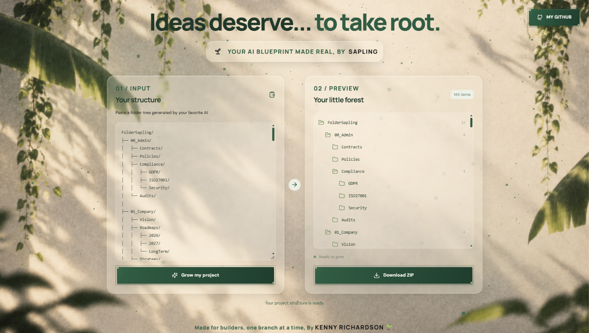

# WATER THIS PLANT🪴

# 🌱 Sapling

### 🪴 From AI blueprint to project structure, one branch at a time.

Sapling turns folder structures generated by your favorite AI agent into downloadable ZIP archives containing the folders and empty file placeholders you need to get started. Paste a tree, preview it, and let your project take root. 🌿

> 🌳 **No AI required. No backend required. No extra machinery.** Just your structure, a parser, and a ZIP file.

## 🚀 Check out the deployed version:

```bash
https://foldersapling.onrender.com
```

## ✨ Features

- 📝 **Paste any folder structure** — use output from your preferred AI agent or write a tree yourself.
- 🌲 **Parse folder trees** — turn supported tree-formatted text into a structured hierarchy.
- 👀 **Preview before growing** — inspect the parsed project structure before downloading.
- 📦 **Download as ZIP** — package folders and empty file placeholders into an archive.
- 🗂️ **Keep files empty** — Sapling creates placeholders; it does not generate application code.
- ⚡ **Lightweight and deterministic** — no AI inference or backend service is needed for the core workflow.
- 🌿 **Botanical interface** — a little greenery for the otherwise deeply unglamorous business of folders.
- 🐙 **GitHub shortcut** — jump straight to the creator's GitHub profile.

## 🚀 How It Works

1. 🧠 Ask your preferred AI agent for a folder/file structure, or create one yourself.
2. 📋 Copy the structure.
3. 🌱 Paste it into Sapling's input panel.
4. 🌳 Select **Grow my project** to parse and preview the structure.
5. 📦 Select **Download ZIP** to save the generated archive.
6. 🛠️ Extract the ZIP and start building your actual project.

## 🧾 Example Input

```text
my-project/
├── src/
│   ├── main.py
│   └── utils.py
├── tests/
│   └── test_main.py
├── README.md
└── requirements.txt
```

The downloaded archive contains the same hierarchy, with empty files and folders ready for you to fill. 🪴

## 🧰 Tech Stack

- ⚛️ **React**
- 🟦 **TypeScript**
- ⚡ **Vite**
- 📦 **JSZip**
- 🎨 **CSS**
- 🎯 **Lucide React** icons

## 💻 Run Locally

### 📋 Prerequisites

- 🟢 Node.js (a current LTS release is recommended)
- 📦 npm, included with Node.js

### 🛠️ Installation

```bash
git clone https://github.com/kennykrichardson/sapling.git
cd sapling
npm install
npm run dev
```

Vite will print a local development URL in your terminal. Open it in your browser. 🌐

> 📌 If your repository uses a different name or URL, replace the clone URL and directory name above with the actual values.

### 🏗️ Production Build

```bash
npm run build
```

### 🔍 Check the Build Locally

```bash
npm run preview
```

## 🧭 Project Principles

- 🌱 **Structure, not implementation:** generated files are empty placeholders.
- 🔒 **Keep secrets out of the frontend:** Sapling does not need AI-provider API keys.
- 🪶 **Keep it simple:** the core workflow is designed to run in the browser without a dedicated backend.
- 🧩 **Bring your own blueprint:** use the AI agent or workflow you already like.

# 🖼️ Screenshots

## 🖥️ FolderSapling



---

_Add your screenshots to this section to show Sapling in action._ 📸

## 🤝 Contributing

Ideas, bug reports, and improvements are welcome! 🌿

1. 🍴 Fork the repository.
2. 🌱 Create a branch for your change.
3. 🛠️ Make your changes and test them.
4. 📬 Open a pull request with a clear explanation.

Please keep contributions focused, accessible, and consistent with Sapling's lightweight approach.

## 🐛 Reporting Issues

If you find a bug, open a GitHub issue with:
- 🧭 Steps to reproduce
- 🧾 The input structure that caused the issue
- 💥 The error or unexpected result
- 🌐 Your browser and operating system, if relevant

Please avoid including secrets or private project data. 🔐

## 📜 License

Sapling is distributed under the **MIT License**. See [`LICENSE`](./LICENSE) for details. ⚖️

## 🌳 Grow Something Good

Made for builders, one branch at a time. 🪴

Created by **[Kenny Richardson](https://github.com/kennykrichardson)** 💚
